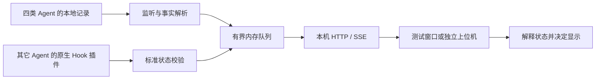

# Agent Status Runtime

轻量的本机 Agent 实时监测与广播服务。面向需要持续获取 Agent 活动状态的桌面上位机、状态指示器和其它本机消费者。

## 功能介绍

核心在后台观察 Codex、Claude Code、DeepSeek DSH 和 Pi 的新活动，也接收其它 Agent 插件主动上报的标准状态，再通过本机 HTTP/SSE 提供给消费者。核心保留事件来源和上报依据，显示什么状态、何时结束计时，由客户端决定。

Windows 用户可从 [Releases](https://github.com/aoang-git/Agent_Status_Runtime/releases) 下载并双击 `agent-status-setup.exe`。安装后立即后台运行，当前用户登录时自动启动，意外退出后由计划任务补启动。更新时运行新版安装器即可，安装成功后可删除下载的安装器。

`agent-status-test.exe` 是单独交付的只读开发工具，用于查看采集来源、事实和通知，验证“来源＋状态＋持续时间”的显示规则。它不会启动或控制核心。正式硬件上位机、串口输出和局域网设备转发尚未实现。Linux/macOS 目前支持手动构建和运行。

安装位置、维护命令、构建测试和自动发布操作见 [运行与开发](doc/运行与开发.md)。

## 监控实现方式和局限性

默认监测依靠 Agent 自身写入本地的会话记录。文件监听配合增量读取、定期检查和新目录发现，将消息、工具、审批及生命周期记录转换为不含正文的事实；内置监测没有安装生命周期 Hook，也不修改 Agent 配置。

核心只广播本次运行期间观察到的新变化。启动时为已有记录建立基线，客户端重连后等待新活动，不恢复旧任务。事实、去重和采集关联只在内存中短期保存；落盘限于连接发现、诊断日志及部署信息，不保存对话正文、提示词、工具参数或结果。

使用时需要了解这些边界：

- 文件写入存在延迟；能观察到某条记录，不等于能持续知道 Agent 内部的即时状态。没有持久化记录、格式变化或读取权限不足时，覆盖会受限。
- 同一种 Agent 的 CLI 和桌面入口不保证使用相同格式。当前有四类格式解析和构造样本回归，尚未完成所有版本、桌面入口、远程和 WSL 场景的实机兼容验证。
- 消息结束和工具返回不能直接证明整个任务成功。测试窗口结合明确结束记录、待处理工具/审批及无进展超时做判断，推断仅作为边界保护。
- 缓存有界，服务重启、断连或消费者落后可能丢失中间变化；这里不提供历史回放、离线补发或必达保证。
- 核心目前只监听本机回环地址。ESP32 等局域网设备不能直接连接，需要后续上位机转发；当前用户注销、电脑休眠或关机期间不提供监测。

测试窗口按接收顺序只显示最新一个轮次。工作、工具和审批切换不会重置任务计时；结束通知短暂展示后清除。更详细的通信及客户端规则见 [接入协议](doc/接入协议.md)。

## 性能评估

2026-10-23 对 Windows 核心进行了一次约 **1.8 小时**的阶段性测试：单个构造来源每约 5 秒追加一条记录，同时保持一个 SSE 订阅者。期间采集到 104 组资源样本，接收到 1237 条事实广播。

| 指标 | 本次观察 |
|---|---|
| CPU 占整机计算能力 | 样本平均约 0.010%，最高约 0.50%（包含启动阶段） |
| 工作集 | 约 13.1–17.7 MiB |
| 私有字节 | 约 47.3–51.6 MiB |
| 进程句柄 | 172–207，后期样本保持 207 |
| 近期队列 | 预热后约 115 条、67 KiB，旧记录持续淘汰 |

这是单来源、低频负载的初步结果，不代表大量会话或高并发下的性能，也不包含测试窗口的资源消耗。72 小时长稳测试尚未完成，不能据此声称已通过长期稳定性验收。

环境、统计口径、复测方法和缺少的验证见 [性能评估](doc/性能评估.md)；已有功能验证见 [验证记录](doc/验证记录.md)。

## 其它 Agent 上报插件接入说明

其它 Agent 可以在自身原生扩展或 Hook 中，把实际运行进展转换为标准状态上报。插件运行在 Agent 一侧，监测核心只负责校验、标记来源和转发，不安装、加载或执行插件。

插件应表达“正在工作、工具活动、等待确认、空闲、完成、中断、失败或未知”，并注明依据来自原生事件、插件推断还是普通自报。每轮使用稳定的操作标识，只在状态变化或真实进展时报告；定时心跳不能冒充任务进展，空闲也不等同于任务成功。

优先使用工具提供的确定性原生回调，不依赖模型记得执行上报命令。工具调用失败可能随后重试，消息结束后也可能继续自动处理，插件需要先确认原生事件的实际含义。报告失败不得拖慢或中断 Agent 本身。

所有来源按核心接收顺序广播；插件声明依据更明确，也不会锁住来源或覆盖后到的文件活动。接入步骤、字段、可运行上报示例和验收要求见 [插件开发](doc/插件开发.md)，完整通信约定见 [接入协议](doc/接入协议.md)。
