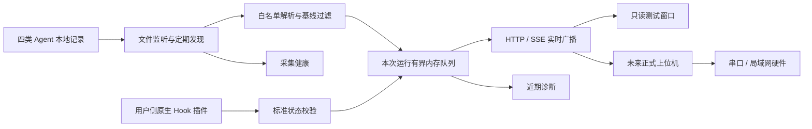

# 当前架构：v0.3

核心不加载插件，不修改 Agent，不做最终状态判断。插件直接上报标准状态；文件侧保留观察事实。所有记录按接收序号广播，没有来源覆盖优先级。

Windows 用户计划任务负责登录启动及每分钟补启动，单实例文件锁避免重复进程。发现文件提供动态端口、令牌、PID 与 epoch。核心活动数据只在内存保留，退出即清空；日志轮转有界。

协议见 [v0.3 接入协议](v0.3接入协议.md)，安装与命令见 [README](../README.md)。
